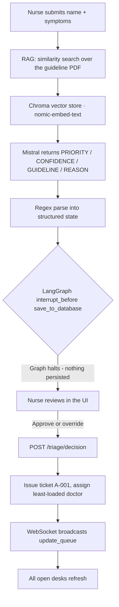

# DringlichAI

An AI-assisted triage desk for an emergency department. The AI reads a patient's symptoms,
matches them against a clinical triage guideline, and proposes a priority level — but **nothing
enters the queue until a nurse approves or overrides it.**

Queue ordering, doctor workload and the whole intake flow are live: every change is broadcast
over a WebSocket, so multiple open desks stay in sync.


The same walkthrough is also available as a smaller, faster [MP4](docs/media/walkthrough.mp4).

---

## What it does

- **Live triage queue** — patients sorted by clinical priority, then arrival time, with a
  waiting-time bar measured against a per-priority target and an "over target" flag.
- **Doctor workload** — per-doctor status (`available` / `on break` / `off duty`), live load
  slots, the patients assigned to each doctor, and staff management.
- **AI intake with a human in the loop** — symptom form → RAG + LLM triage → nurse review
  showing the AI's confidence, its reasoning, and the guideline it matched.
- **Workload-aware assignment** — new patients are auto-assigned to the least-loaded doctor
  who is not off duty.
- **Undo** — removing a treated patient raises a toast with an undo action.
- **German / English** — the whole UI is bilingual, switchable from the top bar.

---

## Screens

### Live triage queue

Four KPIs, search, priority filters and a priority-sorted grid. The waiting bar turns amber as a
patient approaches the target wait and orange once they pass it.


### Doctor workload

Status pills, load slots against a cap of 4 patients, the individual patient list per doctor, and
break / off-duty controls. Setting a doctor off duty re-assigns their patients to the
least-loaded available colleague.


### AI intake — three stages

**1. Details** — name, symptoms (with quick-add chips) and arrival time.


**2. AI triage** — retrieval runs against the guideline, then Mistral scores the urgency.


**3. Nurse approval** — the suggested level, the AI's confidence, *why* it chose that level, the
matched guideline, the auto-assigned doctor, and P1–P5 override pills. Approving issues a queue
ticket; rejecting drops the case entirely.


### Approved, treated and undo

Once approved the patient appears in the queue with their ticket, AI confidence and a "New" tag.
Marking them treated raises a toast with an undo action.


### Bilingual UI


---

## How the AI triage works



1. **Retrieval.** The symptom text is embedded with `nomic-embed-text` and matched against
   chunks of `DringlichAI_Mock_Triage_Guide.pdf` stored in a local Chroma collection. The top 2
   passages are injected into the prompt.
2. **Scoring.** `mistral:latest` is asked for exactly four labelled lines — `PRIORITY`,
   `CONFIDENCE`, `GUIDELINE`, `REASON` — which are parsed with a regex chain and clamped
   (priority 1–5, confidence 0–100).
3. **Human in the loop.** The graph declares `interrupt_before=["save_to_database"]`, so a triage
   call computes a suggestion and then *halts*. No patient row is written. This is the core
   safety property of the system, not a UI convention.
4. **Decision.** `POST /triage/decision` resumes the graph. On approval the patient is persisted
   with a generated ticket and the assigned doctor; a `priority_override` from the nurse replaces
   the AI's level before it is stored.

For reference, a chest-pain case returns in roughly 5–12 seconds on a laptop:

```json
{
  "status": "pending_approval",
  "patient_name": "Precheck Patient",
  "assigned_doctor": "Dr. med. Stefan Weber",
  "ai_suggested_priority": 1,
  "ai_confidence": 100,
  "ai_reasoning": "The patient is experiencing sudden severe chest pain, has collapsed, and is sweating heavily.",
  "ai_guideline": "CP-01"
}
```

---

## Priority model

| Level | Label | Target wait | Colour |
|-------|-------------|-------------|--------|
| P1 | Immediate | 5 min | red |
| P2 | Very urgent | 10 min | orange |
| P3 | Urgent | 30 min | amber |
| P4 | Standard | 90 min | blue |
| P5 | Non-urgent | 120 min | slate |

Targets live in [priority.js](frontend/src/lib/priority.js) and drive the waiting bars, the
"over target" KPI and the overdue flags.

---

## Tech stack

| Layer | Technology |
|---|---|
| Backend | FastAPI · Uvicorn · SQLite |
| AI orchestration | LangGraph `StateGraph` + `MemorySaver`, `interrupt_before` for HITL |
| LLM / embeddings | `mistral:latest` · `nomic-embed-text:latest` via Ollama |
| Retrieval | Chroma · LangChain `RecursiveCharacterTextSplitter` · `pypdf` |
| Frontend | React 18 · Vite 5 |
| Realtime | Native WebSocket |
| Styling | Hand-written CSS with design tokens — no UI framework |

---

## Project structure

```
dringlichAI/
├── api.py                       # FastAPI app: REST + WebSocket + serves the built SPA
├── priority_analyzer_agent.py   # LangGraph RAG triage graph (the AI)
├── triagestore.py               # one-off: embeds the guideline PDF into Chroma
├── main.py                      # CLI-only triage demo, no UI
├── DringlichAI_Mock_Triage_Guide.pdf
├── frontend/
│   ├── src/
│   │   ├── App.jsx              # state, fetching, WebSocket, intake + queue flows
│   │   ├── components/          # Sidebar, Topbar, QueueScreen, DoctorsScreen,
│   │   │                        # IntakeDrawer, Toast, KpiCard, Icons
│   │   ├── lib/                 # api.js · i18n.js · priority.js
│   │   └── styles.css           # design tokens + all components
│   ├── vite.config.js           # dev proxy to the API on :8000
│   └── package.json
└── docs/media/                  # README screenshots and walkthrough
```

---

## Getting started

**Prerequisites:** Python 3.12+, Node 20+, and [Ollama](https://ollama.com) running locally.

### 1. Backend

```bash
python3 -m venv .venv
source .venv/bin/activate

pip install fastapi "uvicorn[standard]" langgraph langchain-core \
  langchain-ollama langchain-community langchain-chroma \
  langchain-text-splitters chromadb pypdf

ollama pull mistral
ollama pull nomic-embed-text

python triagestore.py        # embeds the guideline PDF into ./chroma_triage_db (run once)
python -m uvicorn api:app --port 8000
```

`triage.db` and `chroma_triage_db/` are created on first run and are gitignored.

### 2. Frontend

The backend serves the production build, so a plain `npm run build` is all you need:

```bash
cd frontend
npm install
npm run build                # emits frontend/dist, served by FastAPI at /
```

Then open **http://localhost:8000**.

For hot reload during development, run the Vite dev server instead — it proxies `/patients`,
`/doctors`, `/triage` and `/ws` to `127.0.0.1:8000`:

```bash
cd frontend
npm run dev                  # http://localhost:5173
```

---

## API reference

| Method | Path | Purpose |
|---|---|---|
| `GET` | `/` | The built SPA (`frontend/dist/index.html`) |
| `GET` | `/patients` | Queue rows — priority, doctor, ticket, AI confidence |
| `POST` | `/patients` | Re-insert a patient (powers the toast **Undo**) |
| `DELETE` | `/patients/{patient_name}` | Remove a treated patient from the queue |
| `GET` | `/doctors` | Roster with status and current active load |
| `POST` | `/doctors` | Add a doctor to staff |
| `PATCH` | `/doctors/{doctor_name}/status` | Set `available` / `break` / `off`. Going `off` reassigns patients and returns `{"reassigned": n}` |
| `POST` | `/triage` | Run retrieval + LLM triage. Returns `ai_suggested_priority`, `ai_confidence`, `ai_reasoning`, `ai_guideline`. **Writes nothing.** |
| `POST` | `/triage/decision` | Nurse approve/reject. Optional `priority_override` (1–5) replaces the AI level |
| `WS` | `/ws` | Broadcasts the literal string `update_queue` on every queue change |

Interactive docs are at `/docs` while the server is running.

---

## Notes and limitations

This is a demonstration project, not a medical device.

- **No authentication.** Anyone who can reach the port can approve triage decisions.
- **Single process.** SQLite plus a single Uvicorn worker; LangGraph's `MemorySaver` checkpointer
  means pending triage threads are lost on restart.
- **Local models.** `mistral:latest` is a small general-purpose model. Priority suggestions are
  illustrative and should never be trusted clinically.
- **Mock guideline.** The triage guide PDF is synthetic, so the retrieved "guidelines" and the
  `CP-01`-style rule IDs are fabricated for the demo.
- **`practice/`** and `.env` are excluded from version control.

No licence file is included yet — add one before reusing any of this.
