<div align="center">

# DringlichAI

**AI-assisted triage for the emergency department — with a clinician in the loop by design.**

The model proposes. The nurse decides.


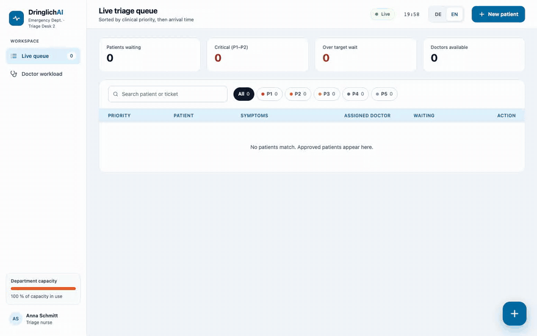

<sub>33-second walkthrough · also available as a smaller, faster [MP4](docs/media/walkthrough.mp4)</sub>

</div>

---

## The problem

An emergency department does not treat patients in arrival order — it ranks them by clinical
urgency, constantly, against a capacity that keeps changing. That ranking (triage) is the
highest-stakes clerical decision in the building.

A language model is genuinely good at the reading part: matching a symptom description against a
guideline and pulling out the relevant rule. It is not something you can let queue a patient
unsupervised. Getting an LLM into clinical work is therefore mostly an *architecture* problem —
how do you take the useful half and make the other half structurally impossible?

DringlichAI is a working answer to that. The AI reads the guideline and forms a judgement, and
then **halts**: the triage graph is defined with `interrupt_before=["save_to_database"]`, so a
suggestion physically cannot reach the database until a nurse approves or overrides it in the UI.

## What it does

- **Live triage queue** — patients ordered by clinical priority then arrival time, each with a
  waiting-time bar measured against a per-priority target and an "over target" flag.
- **Doctor workload board** — per-doctor status (`available` / `on break` / `off duty`), live load
  against a cap, the patients assigned to each doctor, and staff management.
- **AI intake with human sign-off** — symptom form → retrieval + LLM triage → nurse review
  showing the suggested level, the model's confidence, *why* it chose it, and the guideline it
  matched, with P1–P5 override pills.
- **Workload-aware assignment** — new patients go to the least-loaded doctor who is not off duty.
- **Realtime across desks** — every queue change is broadcast over a WebSocket, so multiple open
  workstations stay consistent without polling.
- **Bilingual** — German and English UI, switchable at runtime.
- **Undo** — removing a treated patient raises a toast with an undo action backed by a real
  restore endpoint.

## Engineering highlights

The parts worth a closer look:

- **Safety is enforced in the graph, not the frontend.** The human-in-the-loop guarantee comes
  from LangGraph's `interrupt_before`, not from hiding a button. A `POST /triage` call returns a
  suggestion and writes nothing — there is no code path from "AI ran" to "patient queued" that
  skips the approval step.
- **Retrieval over a real guideline document.** Symptoms are embedded locally with
  `nomic-embed-text` and matched against chunks of the triage guide PDF held in Chroma; the top
  passages are injected into the prompt, and the matched rule ID is surfaced back to the nurse as
  evidence rather than hidden behind a score.
- **Structured extraction instead of parsing prose.** The model is constrained to four labelled
  lines (`PRIORITY` / `CONFIDENCE` / `GUIDELINE` / `REASON`), parsed with a fallback regex chain
  and clamped to valid ranges — so a chatty model response degrades safely instead of crashing
  the request.
- **Migrations that don't destroy data.** The queue gained tickets, confidence and doctor status
  *after* the first schema existed, so the app ships a `PRAGMA table_info` + `ALTER TABLE` helper
  that upgrades an existing `triage.db` in place rather than requiring a reset.
- **Workload rebalancing as a domain rule.** Taking a doctor off duty is not a status flag — it
  reassigns that doctor's patients to the least-loaded available colleague and reports how many
  moved, inside one transaction.
- **Runs entirely on local models.** No API keys, no per-request cost, no patient data leaving
  the machine — a deliberate constraint for anything touching clinical data.

## Architecture

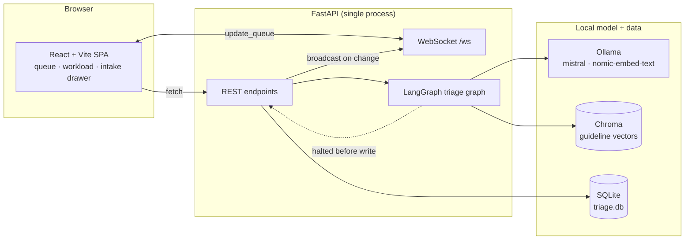

In production the same FastAPI process also serves the built SPA, so the whole application
deploys as one service on one port.

## Design decisions

| Decision | Why |
|---|---|
| HITL enforced via `interrupt_before` in the graph | A UI-only guard is a convention that the next caller can bypass; a graph interrupt is a property of the system |
| Local models via Ollama | Keeps patient data on-premise and removes per-request cost and API-key handling |
| SQLite with in-place migrations | Right weight for a single-desk workload, and it let the schema evolve without throwing away data |
| WebSocket broadcast instead of polling | Queue state must be consistent across desks the moment it changes |
| No UI framework, hand-written CSS tokens | The design is specific; a component library would have been fought more than used |
| Optimistic list update + real restore endpoint for Undo | Instant feedback in the UI, but the undo is a genuine server round trip rather than a client-side illusion |

## The AI pipeline

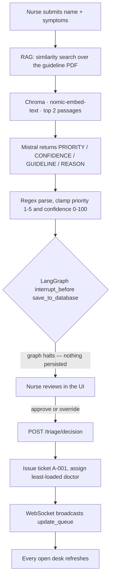

A real response from a chest-pain case (this is the model's actual output, and the screenshot
further down is that same call rendered in the review drawer):

```json
{
  "status": "pending_approval",
  "patient_name": "Precheck Patient",
  "assigned_doctor": "Dr. med. Stefan Weber",
  "ai_suggested_priority": 1,
  "ai_confidence": 100,
  "ai_reasoning": "The patient is experiencing sudden severe chest pain, has collapsed, and is sweating heavily.",
  "ai_guideline": "CP-01"
}
```

End-to-end latency is roughly **5–12 seconds** on a laptop CPU — long enough that the UI treats
it as a real state with its own loading stage rather than a spinner flash.

## Priority model

| Level | Label | Target wait | Colour |
|-------|-------------|-------------|--------|
| P1 | Immediate | 5 min | red |
| P2 | Very urgent | 10 min | orange |
| P3 | Urgent | 30 min | amber |
| P4 | Standard | 90 min | blue |
| P5 | Non-urgent | 120 min | slate |

Targets live in [priority.js](frontend/src/lib/priority.js) and drive the waiting bars, the
"over target" KPI and the overdue flags. A doctor's load is measured against a cap of 4.

## Screens

### Live triage queue

Four KPIs, search, priority filters and a priority-sorted grid. The waiting bar turns amber as a
patient approaches the target wait and orange once they pass it.

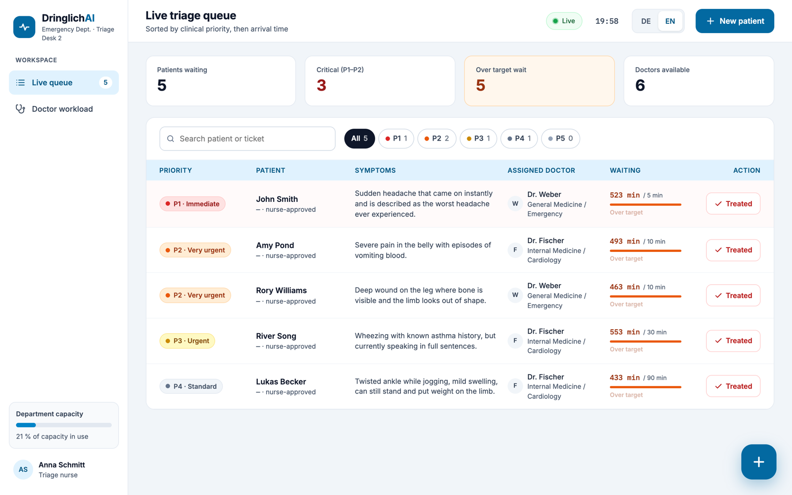

### Doctor workload

Status pills, load slots, per-doctor patient lists, and break / off-duty controls. Setting a
doctor off duty re-assigns their patients to the least-loaded available colleague.

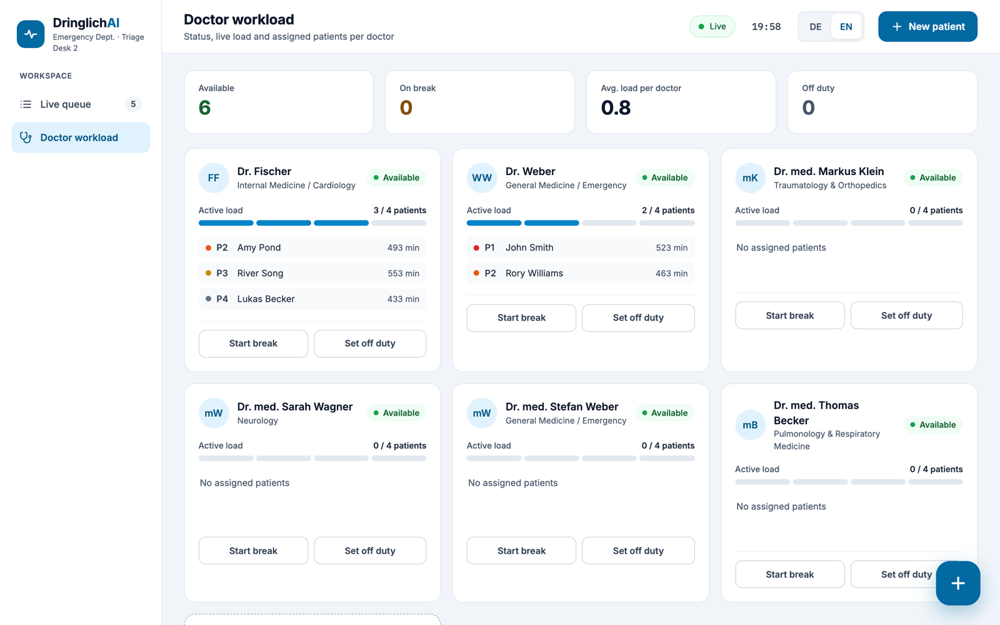

### AI intake — three stages

**1. Details** — name, symptoms with quick-add chips, and arrival time.

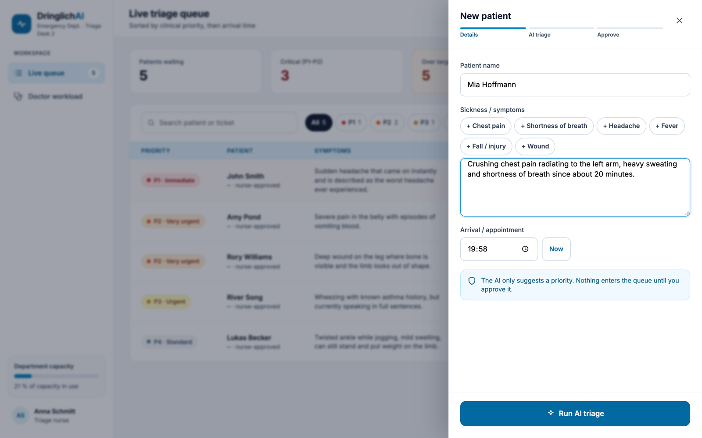

**2. AI triage** — retrieval runs against the guideline, then Mistral scores the urgency.

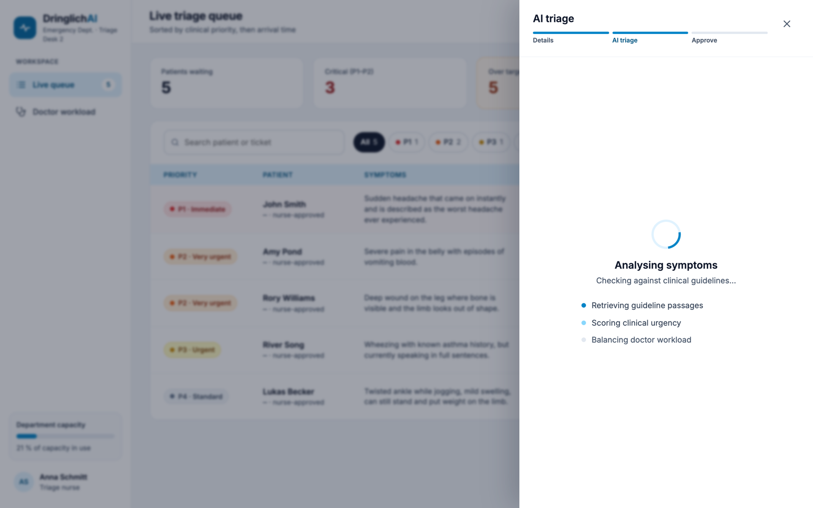

**3. Nurse approval** — the suggested level, the model's confidence, *why* it chose it, the
matched guideline, the auto-assigned doctor, and P1–P5 overrides. Approving issues a queue
ticket; rejecting drops the case entirely.

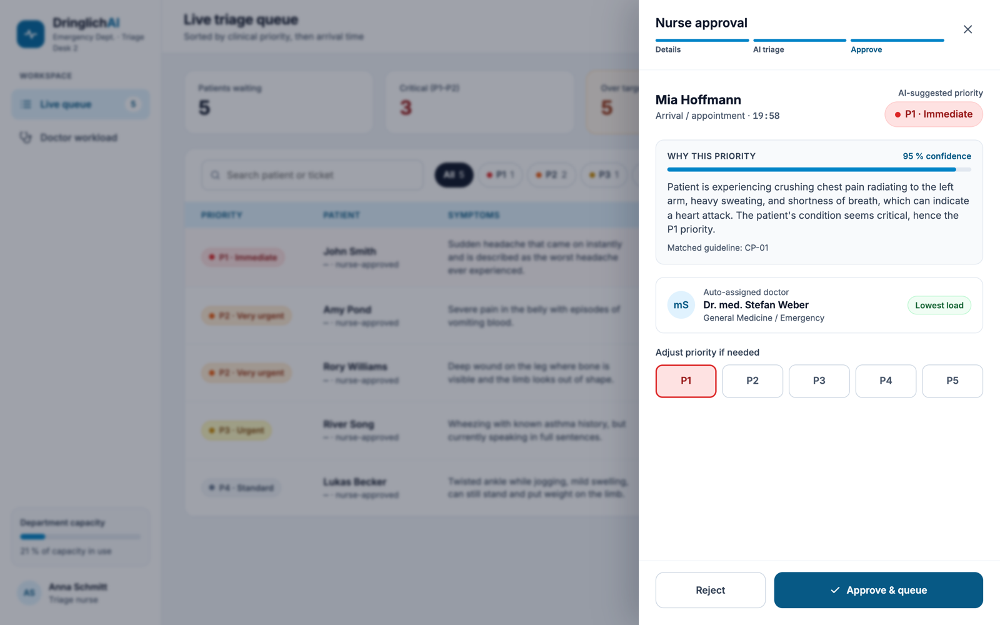

### Approved, treated and undo

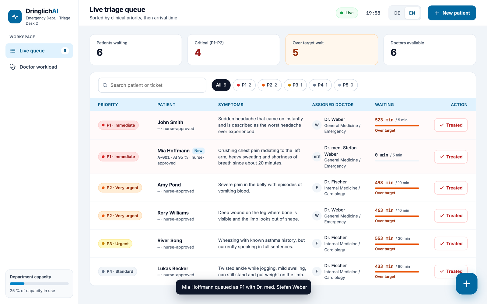

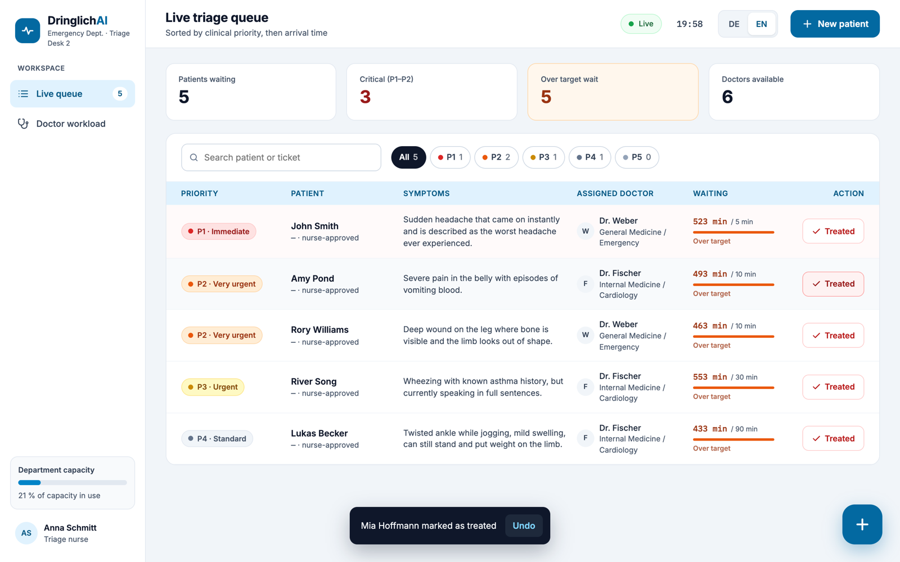

### Bilingual UI

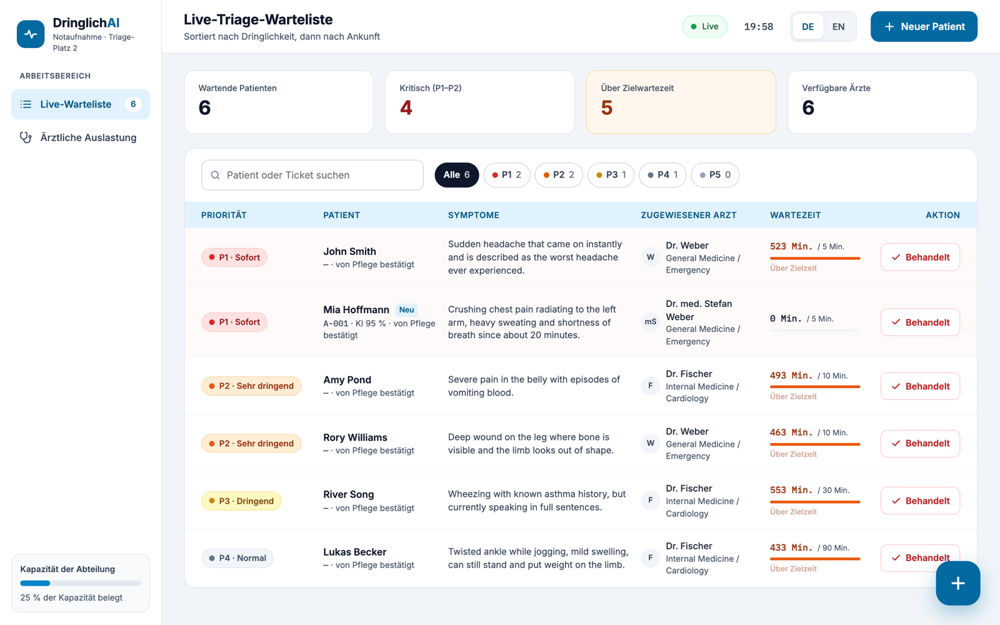

## Tech stack

| Layer | Technology |
|---|---|
| Backend | FastAPI · Uvicorn · SQLite |
| AI orchestration | LangGraph `StateGraph` + `MemorySaver`, `interrupt_before` for HITL |
| LLM / embeddings | `mistral:latest` · `nomic-embed-text:latest` via Ollama |
| Retrieval | Chroma · LangChain `RecursiveCharacterTextSplitter` · `pypdf` |
| Frontend | React 18 · Vite 5 |
| Realtime | Native WebSocket |
| Styling | Hand-written CSS with design tokens — no UI framework |

## Getting started

**Prerequisites:** Python 3.12+, Node 20+, and [Ollama](https://ollama.com) running locally.

### 1. Backend

```bash
python3 -m venv .venv
source .venv/bin/activate

pip install fastapi "uvicorn[standard]" langgraph langchain-core \
  langchain-ollama langchain-community langchain-chroma \
  langchain-text-splitters chromadb pypdf

ollama pull mistral
ollama pull nomic-embed-text

python triagestore.py        # embeds the guideline PDF into ./chroma_triage_db (run once)
python -m uvicorn api:app --port 8000
```

`triage.db` and `chroma_triage_db/` are created on first run and are gitignored.

### 2. Frontend

The backend serves the production build, so a plain `npm run build` is all you need:

```bash
cd frontend
npm install
npm run build                # emits frontend/dist, served by FastAPI at /
```

Then open **http://localhost:8000**.

For hot reload during development, run the Vite dev server instead — it proxies `/patients`,
`/doctors`, `/triage` and `/ws` to `127.0.0.1:8000`:

```bash
cd frontend
npm run dev                  # http://localhost:5173
```

## API reference

Nine REST endpoints and one WebSocket channel.

| Method | Path | Purpose |
|---|---|---|
| `GET` | `/` | The built SPA (`frontend/dist/index.html`) |
| `GET` | `/patients` | Queue rows — priority, doctor, ticket, AI confidence |
| `POST` | `/patients` | Re-insert a patient (powers the toast **Undo**) |
| `DELETE` | `/patients/{patient_name}` | Remove a treated patient from the queue |
| `GET` | `/doctors` | Roster with status and current active load |
| `POST` | `/doctors` | Add a doctor to staff |
| `PATCH` | `/doctors/{doctor_name}/status` | Set `available` / `break` / `off`. Going `off` reassigns patients and returns `{"reassigned": n}` |
| `POST` | `/triage` | Run retrieval + LLM triage. Returns `ai_suggested_priority`, `ai_confidence`, `ai_reasoning`, `ai_guideline`. **Writes nothing.** |
| `POST` | `/triage/decision` | Nurse approve/reject. Optional `priority_override` (1–5) replaces the AI level |
| `WS` | `/ws` | Broadcasts the literal string `update_queue` on every queue change |

Interactive docs are at `/docs` while the server is running.

## Project structure

```
dringlichAI/
├── api.py                       # FastAPI app: REST + WebSocket + serves the built SPA
├── priority_analyzer_agent.py   # LangGraph RAG triage graph (the AI)
├── triagestore.py               # one-off: embeds the guideline PDF into Chroma
├── main.py                      # CLI-only triage demo, no UI
├── DringlichAI_Mock_Triage_Guide.pdf
├── frontend/
│   ├── src/
│   │   ├── App.jsx              # state, fetching, WebSocket, intake + queue flows
│   │   ├── components/          # Sidebar, Topbar, QueueScreen, DoctorsScreen,
│   │   │                        # IntakeDrawer, Toast, KpiCard, Icons
│   │   ├── lib/                 # api.js · i18n.js · priority.js
│   │   └── styles.css           # design tokens + all components
│   ├── vite.config.js           # dev proxy to the API on :8000
│   └── package.json
└── docs/media/                  # README screenshots and walkthrough
```

## Roadmap

The honest next steps, in the order I would take them:

1. **Authentication and roles.** Today anyone who can reach the port can approve triage
   decisions. This is the first thing that has to change.
2. **Persist the graph state.** `MemorySaver` means a pending triage thread is lost on restart;
   a SQLite or Postgres checkpointer fixes that and enables multi-worker deployment.
3. **Write the override audit trail.** The review screen tells the nurse their change is logged
   with their name — that audit table is the next thing to build.
4. **Stream the triage stages.** The loading state is currently honest but opaque; streaming the
   retrieval and scoring steps would make the waiting time informative.

## Limitations

This is a demonstration project, not a medical device.

- **No authentication** — anyone who can reach the port can approve triage decisions.
- **Single process** — SQLite plus a single Uvicorn worker.
- **Local models** — `mistral:latest` is a small general-purpose model. Priority suggestions are
  illustrative and must never be trusted clinically.
- **Mock guideline** — the triage guide PDF is synthetic, so the retrieved rules and the
  `CP-01`-style rule IDs are fabricated for the demo.
- **Not validated** — no clinical validation, no test suite yet, and `practice/` and `.env` are
  excluded from version control.

## Author

Built by **Eseosa Edosomwan** — [@esosaphilip](https://github.com/esosaphilip)

## Licence

MIT — see [LICENSE](LICENSE).
